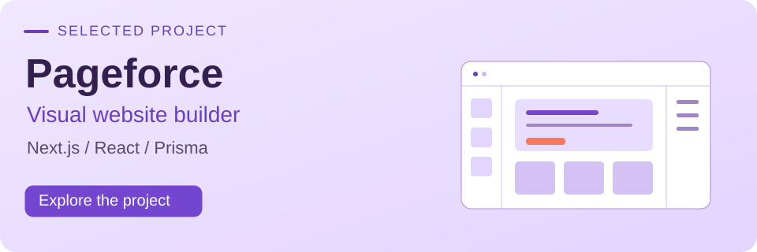
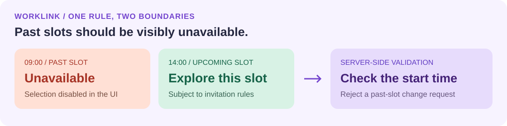
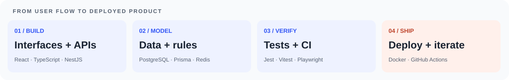

  

I’m Minh, a <strong>full-stack developer</strong> working with React, TypeScript, NestJS, and PostgreSQL. I build interfaces, APIs, and the business rules that connect them — from interview scheduling to visual editors and court reservations.

  
  
  

## Selected work

### WorkLink · Job matching platform

G31 team project · React · NestJS · PostgreSQL / pgvector

Job discovery, applications, interviews, chat, and payments for the Vietnamese labor market. <strong>My contributions:</strong> interview slot validation across the UI and API, a Socket.io hook and typing indicator, backend tests, and frontend CI/CD.

<a href="https://worklink.id.vn"><strong>Live product ↗</strong></a> · <a href="https://github.com/minhtt22-26/sepbe_G31">Backend</a> · <a href="https://github.com/he170794kieudinhdoan-lang/sepfe_G31">Frontend</a> · <a href="./docs/worklink-scheduling-story.md"><strong>My case study →</strong></a>

<table>
  <tr>
    <td width="50%" valign="top">
      
      
<strong>Build a website by composing blocks.</strong> Typed JSON blocks and a renderer shared by editing previews and published pages.

      
Next.js · React · Prisma · Supabase Ownership checks · Lead capture · Migrations

      
<a href="https://pageforce.vercel.app"><strong>Demo ↗</strong></a> · <a href="https://github.com/MinhTT2/pageforce">Code</a> · <a href="https://github.com/MinhTT2/pageforce/blob/main/docs/showcase.md">Product tour</a>

    </td>
    <td width="50%" valign="top">
      
      
<strong>Find a court. Reserve a time.</strong> Court discovery and booking with database-backed reservation rules and payment updates.

      
Next.js · PostgreSQL · Supabase Overlap protection · Expiring holds · Webhooks

      
<a href="https://san-ngon.vercel.app"><strong>Demo ↗</strong></a> · <a href="https://github.com/MinhTT2/san-ngon">Code</a> · <a href="https://github.com/MinhTT2/san-ngon#những-quyết-định-kỹ-thuật-chính">Engineering decisions</a>

    </td>
  </tr>
</table>

## A closer look at my code

<strong>What happens when an interview slot has already started?</strong> I made past slots visibly unavailable in the interface and added a server-side check for slot changes. The API also needs to handle a request from a page left open past the slot’s start.

<a href="./docs/worklink-scheduling-story.md">Read the problem, decisions, and tradeoffs →</a> · <a href="https://github.com/minhtt22-26/sepbe_G31/commit/6633809ebe5b796e57cad1176b079bf7099449dc">API diff</a> · <a href="https://github.com/he170794kieudinhdoan-lang/sepfe_G31/commit/ef767e28c864400e0bc177c9fcb636f97ee78a24">UI diff</a>

  
<strong>WorkLink — selected changes I authored</strong>

   
  

  <table>
    <tr><th align="left">Area</th><th align="left">My contribution</th><th align="left">Public evidence</th></tr>
    <tr><td>Interview scheduling</td><td>Disabled past slots in the UI, rejected past-slot changes in the API, and refined upcoming-slot and pending-invitation queries.</td><td><a href="https://github.com/minhtt22-26/sepbe_G31/commit/6633809ebe5b796e57cad1176b079bf7099449dc">API</a> · <a href="https://github.com/he170794kieudinhdoan-lang/sepfe_G31/commit/ef767e28c864400e0bc177c9fcb636f97ee78a24">UI</a></td></tr>
    <tr><td>Real-time chat</td><td>Added a Socket.io hook and typing indicator.</td><td><a href="https://github.com/he170794kieudinhdoan-lang/sepfe_G31/commit/118863374b62e5c59fa3ef9f0a3bfebafac790a8">Commit</a></td></tr>
    <tr><td>Backend quality</td><td>Expanded tests for services, DTOs, and infrastructure, including the Redis provider.</td><td><a href="https://github.com/minhtt22-26/sepbe_G31/commit/5f4b7b33d56f4e2c6830734c4ecf4a7945632802">Tests</a></td></tr>
    <tr><td>Delivery &amp; resilience</td><td>Added frontend CI/CD workflows and a top-level error boundary for render failures.</td><td><a href="https://github.com/he170794kieudinhdoan-lang/sepfe_G31/commit/37c7d5d557651701d0e884b47cc31362bfb7d6ae">CI/CD</a> · <a href="https://github.com/he170794kieudinhdoan-lang/sepfe_G31/commit/df882f9dac90df6eff1952b388bac86cf7af59c0">Error boundary</a></td></tr>
  </table>
  
Built with the G31 team. My contributions span <a href="https://github.com/MinhTT2">MinhTT2</a> and my earlier account <a href="https://github.com/minhtt22-26">minhtt22-26</a>. The wider matching, chat, and payment systems are team work.

  
<strong>My commit history:</strong> Backend — <a href="https://github.com/minhtt22-26/sepbe_G31/commits/main/?author=minhtt22-26">earlier account</a> / <a href="https://github.com/minhtt22-26/sepbe_G31/commits/main/?author=MinhTT2">current account</a> · Frontend — <a href="https://github.com/he170794kieudinhdoan-lang/sepfe_G31/commits/main/?author=minhtt22-26">earlier account</a> / <a href="https://github.com/he170794kieudinhdoan-lang/sepfe_G31/commits/main/?author=MinhTT2">current account</a>

  
<strong>Pageforce — see the builder and shared renderer</strong>

   
  
  
The editor and public pages share a <a href="https://github.com/MinhTT2/pageforce/blob/main/src/components/blocks/BlockRenderer.tsx">block renderer</a>, keeping editing previews aligned with what visitors see. Follow the <a href="https://github.com/MinhTT2/pageforce/blob/main/docs/showcase.md">product walkthrough</a>.

  
<strong>Sân Ngon — inspect reservation rules</strong>

  
Start with the <a href="https://github.com/MinhTT2/san-ngon/blob/main/supabase/migrations/20260925000000_booking_holds.sql">booking hold logic</a>, then read the <a href="https://github.com/MinhTT2/san-ngon#những-quyết-định-kỹ-thuật-chính">engineering decisions</a> behind reservations and payments.

## How I build

  
<strong>Technology toolbox</strong>

  <table>
    <tr><th align="left">Area</th><th align="left">Tools</th></tr>
    <tr><td>Frontend</td><td>React, Next.js, TypeScript, Vite, Tailwind CSS, TanStack Query</td></tr>
    <tr><td>Backend</td><td>NestJS, REST APIs, Redis, Bull, Socket.io</td></tr>
    <tr><td>Data &amp; AI integration</td><td>PostgreSQL, pgvector, Prisma, Supabase, Gemini embeddings</td></tr>
    <tr><td>Quality &amp; delivery</td><td>Jest, Vitest, Playwright, ESLint, GitHub Actions, Docker, Vercel</td></tr>
    <tr><td>Also exploring</td><td><a href="https://github.com/MinhTT2/learning-vuejs">Vue 3 and Vue Router</a></td></tr>
  </table>

Some professional work lives in private repositories; anonymized contributions are visible on my profile. The projects above show the code and engineering decisions I can share publicly.

