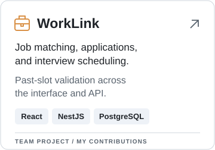
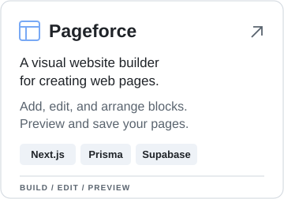
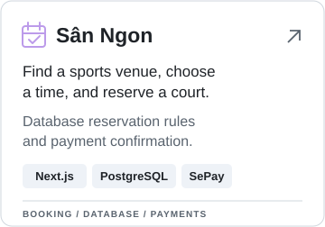

## 👋 Hi there, I’m Minh Tien Tran!

**Full-stack developer** · React, TypeScript, NestJS & PostgreSQL 
I build web interfaces, APIs, and the business rules that connect them.

### Tech Stack

  
  
  
  
  
   
  
  
  
  
  
  

### Featured Projects

<table>
  <tr>
    <td width="33%" valign="top">
      <a href="./docs/worklink-scheduling-story.md"><picture><source media="(prefers-color-scheme: dark)" srcset="./assets/compact/worklink-dark.svg" /></picture></a>
      
<a href="https://worklink.id.vn">Demo ↗</a> · <a href="./docs/worklink-scheduling-story.md">My contribution</a>

    </td>
    <td width="33%" valign="top">
      <a href="https://github.com/MinhTT2/pageforce"><picture><source media="(prefers-color-scheme: dark)" srcset="./assets/compact/pageforce-dark.svg" /></picture></a>
      
<a href="https://pageforce.vercel.app">Demo ↗</a> · <a href="https://github.com/MinhTT2/pageforce">Code</a> · <a href="https://github.com/MinhTT2/pageforce/blob/main/docs/showcase.md">Tour</a>

    </td>
    <td width="33%" valign="top">
      <a href="https://github.com/MinhTT2/san-ngon"><picture><source media="(prefers-color-scheme: dark)" srcset="./assets/compact/san-ngon-dark.svg" /></picture></a>
      
<a href="https://san-ngon.vercel.app">Demo ↗</a> · <a href="https://github.com/MinhTT2/san-ngon">Code</a> · <a href="https://github.com/MinhTT2/san-ngon#những-quyết-định-kỹ-thuật-chính">Design</a>

    </td>
  </tr>
</table>

### Engineering Notes

| | Read more |
| --- | --- |
| 📄 **WorkLink: when an interview slot has already started** | [Problem, my changes & tradeoffs →](./docs/worklink-scheduling-story.md) |
| 🧩 **Pageforce: one schema from editing to publishing** | [Shared renderer & product tour →](https://github.com/MinhTT2/pageforce/blob/main/docs/showcase.md) |
| 🗓️ **Sân Ngon: keeping court reservations consistent** | [Database rules & design decisions →](https://github.com/MinhTT2/san-ngon#những-quyết-định-kỹ-thuật-chính) |

<strong>Code, tests & my contribution history</strong>

| Project | Evidence |
| --- | --- |
| WorkLink · team project | [My API change](https://github.com/minhtt22-26/sepbe_G31/commit/6633809ebe5b796e57cad1176b079bf7099449dc) · [My UI change](https://github.com/he170794kieudinhdoan-lang/sepfe_G31/commit/ef767e28c864400e0bc177c9fcb636f97ee78a24) · [My backend test changes](https://github.com/minhtt22-26/sepbe_G31/commit/5f4b7b33d56f4e2c6830734c4ecf4a7945632802) |
| Pageforce | [Validator tests](https://github.com/MinhTT2/pageforce/blob/main/src/lib/validators.test.ts) · [CI](https://github.com/MinhTT2/pageforce/actions/workflows/ci.yml) · [History](https://github.com/MinhTT2/pageforce/commits/main/) |
| Sân Ngon | [Booking checks](https://github.com/MinhTT2/san-ngon/blob/main/scripts/check-booking-holds.sql) · [SQL CI](https://github.com/MinhTT2/san-ngon/actions/workflows/sql-ci.yml) · [History](https://github.com/MinhTT2/san-ngon/commits/main/) |

My WorkLink contributions span **MinhTT2** and my earlier account **[minhtt22-26](https://github.com/minhtt22-26)**. The wider platform is team work.

**[Review my work in 5 minutes →](./docs/review-guide.md)** · [Browse repositories →](https://github.com/MinhTT2?tab=repositories)

Private work contributes to the activity graph below. Public projects provide code, tests, and decisions you can inspect.
